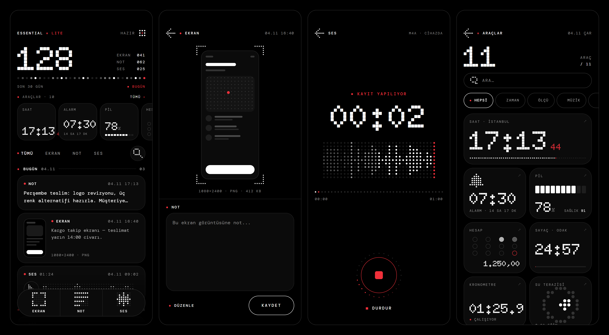
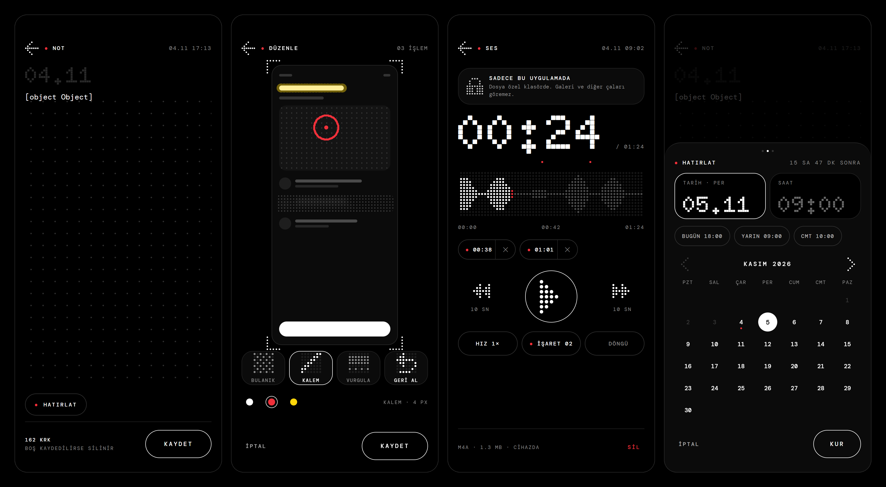
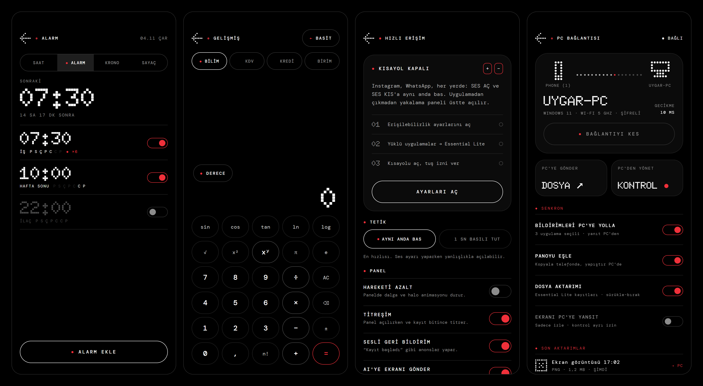
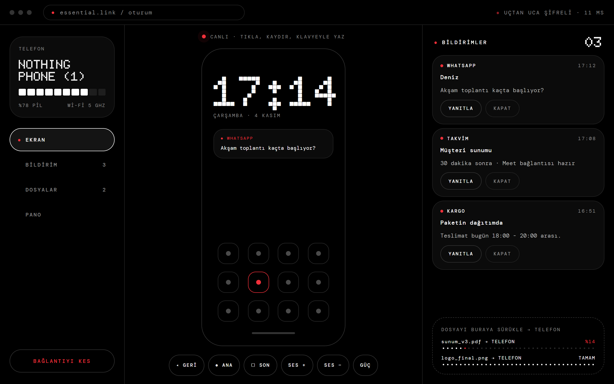

<h1 align="center">ESSENTIAL ● LITE</h1>

<p align="center"><b>Capture anything in two keys.</b><br>
A Nothing OS-style Android app for screenshots, notes and voice memos, with a quick-access panel, a dot-matrix toolbox and a phone ↔ PC link.</p>

<p align="center">
  
  
  
  
</p>

<p align="center"></p>

> Fan project, not affiliated with Nothing. The app's interface is in Turkish.

## Capture

Press **volume up + volume down** together from any app and the quick-access panel opens on top of it: grab the screen, jot a note or start a voice memo without leaving what you're doing.

- **Screenshots** with OCR. Tap text on the capture to select and copy it; phone numbers, IBANs, dates, tracking codes and links become tappable.
- **Notes** with reminders, saved from the clipboard or shared from other apps.
- **Voice memos** (M4A, on device) with a live dot-matrix level meter and a built-in player.
- **Markup editor** to crop and draw on screenshots, export to PDF.
- **Assistant**: long-press the power button to read the screen and pick text from it.

<p align="center"></p>

## Tools

Clock, alarm, stopwatch, timer, basic and scientific calculator (VAT, loan, unit conversion), metronome, spirit level, battery health and a password generator, all drawn in the same dot-matrix style. Alarms can light up the **Nothing Glyph** interface with breathe, strip and blink patterns.

## Phone ↔ PC

Pair with your computer by scanning a QR code. The link is encrypted end to end and nothing is stored on a server.

- Send notifications, clipboard and files to the PC
- Mirror the screen (view only) or control the phone from the PC with separate permission
- PC side is a small Node.js app in [`pc/`](pc): run `pc/baslat.bat`

<p align="center"></p>
<p align="center"></p>

## Privacy

Everything stays on the device. Backups are optional and encrypted with your password (AES-GCM) before they leave the phone. A vault with biometric app lock keeps private captures separate.

## Build

Requirements: Android Studio (JDK 17), Android SDK 36.

```bash
git clone https://github.com/wwGuGuww/EssentialLite
```

Open the folder in Android Studio and run the `app` configuration. Minimum Android 8.0 (API 26). Glyph features need a Nothing phone; everything else works on any Android device.

## Credits

- Dot-matrix type: [Doto](https://fonts.google.com/specimen/Doto) (SIL Open Font License, see `licenses/`)
- Glyph lighting: Nothing Glyph Matrix SDK (`app/libs/`)
